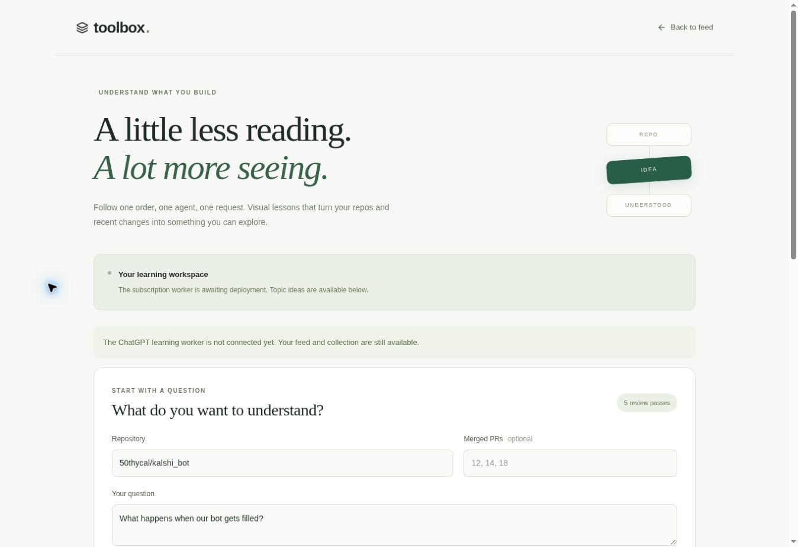

# Visual learning v1 — implementation and verification

Reviewed October 23, 2026 (America/Chicago).

The existing AI Toolbox feed gains a Learn screen and repo-card entry points. A separate Node 24
worker uses the official Codex client's ChatGPT subscription connection. A lesson pins source evidence,
passes through five model review cycles with generated-HTML browser checks, persists in SQLite and
can be reopened or exported as offline interactive HTML. The village's service and login are untouched.

## Five implementation review cycles

1. **Evidence and boundaries:** inspected the actual `ai-toolbox/web` app and Little Commons' pinned
   client implementation. Added commit-pinned evidence, source IDs, excerpt limits and owner/service
   authorization. Hosted generation is explicitly authorized by the current feature request.
2. **Core behavior:** exercised queued five-pass completion, idempotency, failure retention, restart
   interruption, private endpoints, proxy CSRF checks and generated-data validation with test fixtures.
3. **Reader and phone rendering:** used the managed browser/CUA on the real React components at desktop
   and 320/390px frame widths. Fixed an SSR/browser timezone mismatch. Selected diagram nodes and
   both scenario choices and verified the corresponding explanation and path changed.
4. **Offline export:** opened the exact self-contained generated HTML template in the browser,
   exercised its diagram/scenario controls, found a 40-character commit causing horizontal overflow
   at 320px and fixed wrapping. Recheck measured equal document/client widths (303px excluding the
   scrollbar). No model content is executed as HTML or JavaScript.
5. **Regression and release preparation:** verified walkthrough playback reaches its final step and
   stops, reran worker/frontend tests and production builds, checked secret isolation and retained the
   official client's unauthenticated handshake result. Temporary fixture routes were removed before
   source packaging. Added a runtime browser-check stage for every generated draft and a test that
   unresolved final browser findings prevent completion.

## Checks completed

- `learning-worker`: eight Node tests pass; model and per-pass browser results are mocked in the
  orchestration tests. HTTP tests exercise a real local server and temporary SQLite database.
- `learning-worker`: `npm run smoke:codex` passes against official `@openai/codex` 0.163.0 in a fresh
  temporary credential home. Initialization and unauthenticated `account/read` only, no inference.
- `web`: existing repo-chat/backup tests and new learning proxy tests pass; TypeScript and Next.js
  production build pass. Existing chat handoffs and collection import/export are preserved.
- CUA manual/browser checks: source-bound reader fixture, alternative scenarios, animated playback,
  responsive layout and standalone export controls. Fixture content is not a real generated lesson.

## Outstanding activation and verification

- Railway's connected app returned `UNAUTHORIZED` / reauthentication required before project discovery.
  No worker service, volume or credentials have been provisioned in the user's account.
- Vercel project `ai-toolbox` was discovered, but reads under its existing team scope returned 403
  requiring team access. Worker URL/token configuration cannot be completed with current access.
- The Docker image and its Chromium installation have not been built here (Docker is unavailable).
  The runtime Playwright checker has not been executed here; this managed authoring environment uses
  CUA for browser checks. Its first real execution requires the deployed worker. Orchestration tests
  verify propagation of its findings, not the Chromium binary or container setup.
- No live subscription generation, three-topic pilot or live five-cycle generated lesson has run.
  Account sign-in and entitlement must be verified after deployment. The UI labels missing worker
  configuration explicitly and does not fabricate lessons or fall back to API billing.

Worker deployment and operation details: [learning-worker/README.md](../learning-worker/README.md).
